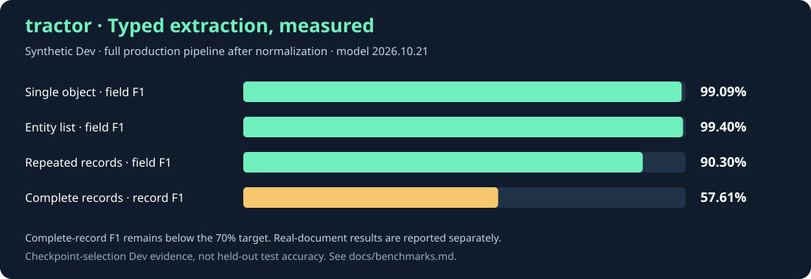

# tractor · System One Extraction Model

This branch adds the experimental [BiQwen backend](docs/manual/how-to/biqwen.md)
with a decoder that preserves multiple values per record field. See the
[pipeline comparison](docs/biqwen-evaluation.md) before choosing a model.


**Text in. Structured data out. Ready for your application.**

tractor is Mayflower’s **System One Extraction Model**: a specialized German/English
model and API for turning readable text into typed fields, separate records and
normalized values. Describe the fields you need. Get JSON your code can use.

Extract names, contact details, identifiers, dates, amounts and quantities from
business documents, messages and other prose. Learned extraction combines with
programmatic normalization using established Python libraries. Run the complete
pipeline on your own infrastructure, on CPU or GPU.

[User manual](docs/manual/index.md) · [Get started](#start-the-api) · [API](docs/api.md) ·
[Benchmarks](docs/benchmarks.md) · [Model card](release/MODEL_CARD.md)

## Put extraction on the fast path

| Your application needs | tractor provides |
|---|---|
| Fields from messy text | Source-span extraction with field descriptions in plain language |
| Consistent typed values | Library-backed parsing, validation and deterministic normalization |
| Repeated records in prose | Anchored records with fields assigned to each explicitly described entry |
| Explicit outcomes | Missing-value, normalization and ambiguity issues |
| Control over deployment | Local, offline serving with CPU or GPU support |
| A small integration surface | One HTTP endpoint and a lightweight Python SDK |

A single encoder pass finds the relevant spans; deterministic code parses and
normalizes the results. Keep repeated extraction local, with one public API and
explicit handling of missing or ambiguous values.

## Specialized extraction, measured

**99.09% field F1 on synthetic single-object Dev requests. 90.30% on fields in
repeated prose records.**

Version **2026.10.21** uses the selected checkpoint from complete training on
**341,237 German/English episodes**. Evaluation covers **4,483 Dev documents**
through the full API pipeline. Complete-record F1 is **57.61%**: strong field
extraction does not mean every record is complete. Real human-annotated Dev field
F1 ranges from **71.03% for contracts to 92.67% for invoices** in the measured sets.



Dev selected the checkpoint; these are not independent test results. Strict
quality and regression gates are not all met. See [results, evidence and known
limitations](docs/benchmarks.md). No latency or Haiku/Luna comparison is claimed
for these weights.

## From source text to application data

A message says **“Die Breite beträgt 12,5 cm.”** Your system needs millimeters.
tractor returns **`125`** under your field name. Other declared field types select
their own parsers and normalizers. Repeated records preserve their field assignments;
missing or ambiguous values produce structured issues.

Use it for document metadata, CRM fields, explicitly named contract parties,
contact details, product attributes and measurements. Inputs and schemas share
a 512-token budget. Validate the complete pipeline on your own workload.

## Start the API

Use the Nix flake development environment. Authenticate with `hf auth login`
using an account with access to the private model repository, then download the
bundle and start the API:

```sh
nix develop
just setup
uv run --no-sync hf download mayflowergmbh/tractor --revision v2026.10.21 --local-dir models/tractor
tractor serve --model models/tractor --device cuda
```

Use `--device cpu` for CPU inference. Serving loads local files offline and does
not download or train a model. `GET /readyz` reports readiness; interactive API
documentation is available at `http://127.0.0.1:8000/docs`.

```sh
curl http://127.0.0.1:8000/v1/extract \
  -H 'Content-Type: application/json' \
  -d '{"text":"Die Breite beträgt 12,5 cm.","locale":"de-DE","fields":{"width_mm":{"type":"quantity","description":"Breite","unit":"mm"}}}'
```

```json
{"data":{"width_mm":125},"issues":[]}
```

## Python SDK

```python
from tractor import Client, Quantity, Text

with Client("http://127.0.0.1:8000") as client:
    result = client.extract(
        "Alpha: Breite 10 cm. Beta: Breite 12 cm.",
        {"product": Text("Produktbezeichnung"),
         "width_mm": Quantity("Breite", unit="mm")},
        anchor="product",
        many=True,
    )
    print(result.data)
```

The result contains separate Alpha and Beta records with widths 100 and 120 mm.
The public response contains only `data` and `issues`. Missing values produce
`null`; competing scalar candidates are returned together with `ambiguous_value`. The SDK imports no ML libraries; `just setup-sdk`
installs its development dependencies without the model stack.

## Evaluation and limits

The selected model improves generalist coverage, with remaining weaknesses in
complete records, restaurant cuisine, product prices and some company/contract
fields. 12 regression checks remain failed. Real evidence is missing for many
domains, and incomplete references are reported as unscored. Calibration and test
remain held out. See [the full evaluation](docs/benchmarks.md) and
[model card](release/MODEL_CARD.md).

## Development

```sh
nix develop
just setup
just check
just check-model models/tractor cpu
```

Python dependencies and native libraries are pinned in `uv.lock` and `flake.lock`.
The CLI also provides data generation, validation, training, evaluation and
benchmark commands; run `tractor --help`. See [architecture](docs/architecture.md)
and [upstream compatibility](docs/upstream-compatibility.md).

## Container

```sh
docker build -t tractor:local .
docker run --rm --user "$(id -u):$(id -g)" -p 127.0.0.1:8000:8000 \
  -v "$PWD/models/tractor:/model:ro" tractor:local
```

The container defaults to CPU. GPU serving requires NVIDIA Container Toolkit;
add `--gpus all` and append `--model /model --device cuda --host 0.0.0.0`.

Source: [mayflower/tractor](https://github.com/mayflower/tractor).
Model: [mayflowergmbh/tractor](https://huggingface.co/mayflowergmbh/tractor). Both repositories are
private during release preparation. Release licensing is not yet selected.
