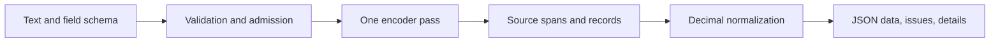

# How the System One extraction system works

tractor is a specialized extraction system for software workflows. Your application
supplies text and a schema; the model selects original source spans, and ordinary
code constructs the response. Field descriptions are semantic queries, while field
keys and target units define the application contract.

This division makes source evidence traceable and unit conversion predictable.
The model decides which text belongs to a field; the normalizer interprets selected
quantities using explicit locale and unit rules. Deterministic conversion does not
make selection infallible: a perfectly converted wrong span remains a wrong answer.

The serving path avoids generating a JSON document token by token. It loads locally,
so no external LLM call is needed for inference. That focused architecture is the
basis of the System One positioning. The [benchmark report](../../benchmarks.md)
measures the released system against prompt-only Haiku and Luna baselines, with
important workload and deployment qualifications.

The API is tractor's own contract. It is not a Jev or OpenAI API compatibility layer.
The released model requires the native tractor/GLiNER loader and is not a generic
Transformers text-generation pipeline. It accepts short text, not PDF files, images,
audio, arbitrary SQL queries, or open-ended chat instructions.

[Architecture implementation](../../architecture.md) · [Record semantics](records.md)

[Manual home](../index.md)
